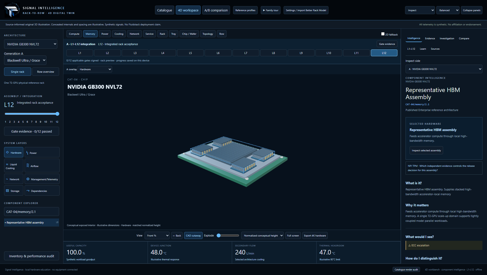

# Signal Intelligence — Rack-to-Row 4D and Rack Catalogue 2.0

Local-first interactive hardware, simulation and diagnostic education. The catalogue adds ten distinct architecture families, synchronized true-3D A/B comparison, twenty synthetic fault cases, source provenance and actual Chromium evidence. The user's visual review reports ≥90/100 for each base family. Engineering limitations remain documented; geometry is original source-informed illustration.

[Open the public Rack Catalogue 2.0](https://floyd-clark.github.io/signal-intelligence-rack-to-row-4d/?catalogue=1)

Every catalogue entry opens the full 4D workbench: architecture explorer, actual hardware, component intelligence, L1–L12 gates and runtime/build timelines. Original reference profiles and offline functionality remain available.



- [Run / application README](signal-intelligence-rack-to-row-4d/README.md)
- [4D convergence changes, screenshots and validation](signal-intelligence-rack-to-row-4d/CATALOGUE_4D_CONVERGENCE.md)
- [Catalogue index](signal-intelligence-rack-to-row-4d/CATALOGUE_INDEX.md)
- [Acceptance and remaining gaps](signal-intelligence-rack-to-row-4d/CATALOGUE_ACCEPTANCE.md)
- [Sources and engineering provenance](signal-intelligence-rack-to-row-4d/CATALOGUE_PROVENANCE.md)

```powershell
& 'C:\Users\floyd\Documents\ChatGPT\Rack Models\signal-intelligence-rack-to-row-4d\scripts\start.ps1'
```

Open http://127.0.0.1:4173/ and choose Rack Catalogue 2.0. Node.js 22.12+ required. The included dist runs offline without node_modules or equipment connections. Original concept, diagnostics, simulation, stable IDs, GLB adapter and L1–L12 remain available. No Fluidstack deployment or vendor endorsement is asserted.
