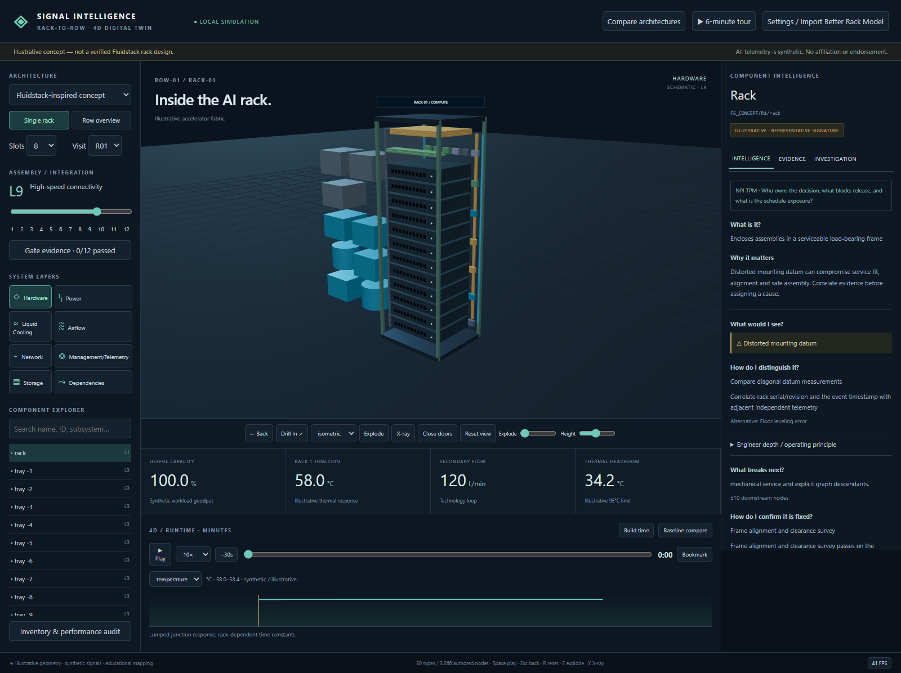

# Signal Intelligence — Rack-to-Row 4D Digital Twin

A working local-first AI infrastructure learning and simulation application, built with React, TypeScript and Three.js. Includes rack/row exploration, 80 component types, 3,266 authored concept nodes, three distinct architecture profiles, L1–L12 gates, 36 investigation presets, deterministic telemetry replay and a local model adapter.

**Visual refinement is the next priority.** The current geometry is schematic and many parts remain boxes. See the [visual feedback brief](signal-intelligence-rack-to-row-4d/VISUAL_FEEDBACK_BRIEF.md) for specific review questions and contribution constraints.



- [Run locally / application README](signal-intelligence-rack-to-row-4d/README.md)
- [Acceptance matrix: 18 green, 6 partial](signal-intelligence-rack-to-row-4d/ACCEPTANCE_MATRIX.md)
- [Assumptions and provenance](signal-intelligence-rack-to-row-4d/ASSUMPTIONS_AND_PROVENANCE.md)
- [3D scene source](signal-intelligence-rack-to-row-4d/src/scene/Scene.tsx)
- [Procedural inventory and stable IDs](signal-intelligence-rack-to-row-4d/src/data/model.ts)

```powershell
cd signal-intelligence-rack-to-row-4d
.\scripts\start.ps1
```

Node.js 22.12+ required. Included production dist runs on 127.0.0.1:4173 without runtime internet or npm dependencies. For source development: npm ci, npm run build, npm test. E2E instructions are in the application README.

This is an educational/illustrative AI-infrastructure digital twin and not an official Fluidstack mechanical design or deployment record. Reference-profile facts and illustrative geometry are explicitly distinguished. No actual equipment controls or live facility connections.
