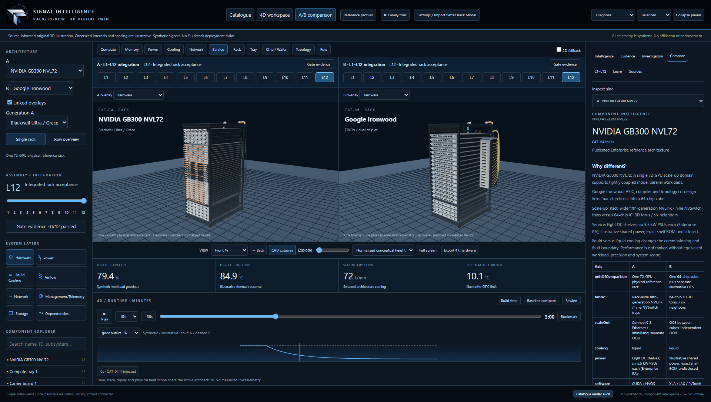

# Catalogue and 4D workbench convergence

Every catalogue card now opens the full three-panel 4D hardware workspace. The catalogue is the architecture library; single-architecture inspection and synchronized A/B comparison use the workbench. The original concept/GB200/TPU reference profiles remain available in the architecture selector.

## What changed

- Shared brand, workbench shell, timeline transport, telemetry chart and component-intelligence sections are consumed by both the original application and catalogue. The original architecture selector also opens catalogue families, and its comparison action opens the working 3D A/B workbench.
- The left rail includes architecture/generation selection, single-rack and illustrative-row views, the L1–L12 slider, earned-gate progress, eight system layers and searchable accessible component navigation.
- The center retains all ten dedicated hardware builders, detailed trays/packages/wafer, cutaway, explosion, camera presets, Back, fallback and 4K export. Twelve integration stages stay visible over each pane. Single-rack and comparison views share the same controls.
- The right inspector provides the original intelligence structure: what/why, failure signature, distinguishing evidence, alternative explanations, operating principle, downstream scope, validation, owner and TPM action. Generic diagnostic principles come from the original component knowledge library, with architecture-specific functions, service graphs and source qualifications.
- Diagnose exposes runtime scrub/play/speed/bookmarks, baseline and A/B traces for nine actual simulation fields. Air-only liquid values remain N/A. Assembly Timeline scrubs installation stages on both panes; the time axis is illustrative, not a supplier schedule or earned acceptance.
- Investigations record independent evidence, hypothesis, containment plan, simulated recovery, hold/release decision and a downloadable incident record. Records are separate per family/generation. Release requires healthy synthetic state, two checks, the authored correct hypothesis, containment and an earned L12 signature newer than the one present at recovery. Rewind recomputes the same deterministic snapshots.
- Semantic layers emphasize real owned hardware. Earlier generic overlay pipes are no longer added. Dependencies follow assembly and service edges; network links do not manufacture a physical failure fan-out.
- Detail builders preserve arbitrary selected carrier IDs, including tray 2, rather than silently selecting the first tray. Owner remapping happens after construction so builders can still annotate their original geometry safely.
- Catalogue settings use the same local asset validator and imported renderer as the original application. Self-contained GLB/glTF, STL and reference PNG inputs require attribution/license and valid component bindings before application. Scale, rotation, X-ray, mapping import/export and procedural restore are available. Mapped meshes retain intelligence, selection, simulation and stage filtering. Imported ownership bounds include the same transforms as rendering. Unmapped meshes remain decorative.
- Resolved generations and service adjacency are cached; UI clock updates do not rebuild Rubin geometry or reconstruct dependency graphs unnecessarily.

## Use

Open the public catalogue, choose **Open 4D workspace**, then inspect meshes or search components. Double-click a tray/package to inspect its detail. Use **Diagnose** for the runtime chart and investigations; use **Assembly Timeline** for build-stage scrubbing. Choose **L1–L12** or **Gate evidence** to run the three synthetic checks, record observations and sign an earned stage. A/B provides an inspector-side selector and linked/independent layer controls.

The supplied logo and blue/silver theme remain shared. No new runtime dependency or external asset request was introduced. The production distribution runs through the existing loopback server without internet.

## Evidence and acceptance

Actual running-application captures: [all ten workspaces and detail/comparison views](evidence/catalogue-v2/workbench/). [Native GPU readings and capture metadata](evidence/catalogue-v2/workbench/native-verification.json). [Browser regression results](evidence/catalogue-v2/workbench/browser-results.json).

| Criterion | Verification / boundary |
|---|---|
| Full 4D layout from all ten cards | Native captures plus browser checks: explorer, layers, intelligence and owned detail |
| Original functionality | Original simulation, diagnostics, row, TPU tray, model import, tour and offline regression workflows retained |
| L1–L12 every entry | 120 named stage previews; 118 applicable signoffs; air-only L4 explicitly N/A; saved evidence, incident blocking and downstream invalidation |
| Arbitrary-carrier identities | Unit/browser checks of second-carrier geometry for all ten families; GB300 HBM tray-2 capture |
| A/B and timeline | Real canvases; orbit, overlays, time/build-stage synchronization; independently scoped family investigations |
| Local model replacement | Catalogue GLB fixture binding/picking, original profile roundtrip, procedural restore and transformed owner bounds |
| Source truth | Existing primary-source register retained; generic intelligence explicitly qualified; no vendor service procedure or live telemetry asserted |
| Visual acceptance | Earlier user ≥90 lower-bound review remains historical; no new independent score assigned to this interface revision |

Production build passed; **52/52 unit tests and all 16 browser workflows were validated**, including all 120 previews and 118 applicable signoffs. The complete browser run took 5.2 minutes with one worker and forced SwiftShader at 1600×1000; its frame rate is not used as a native GPU benchmark. [Machine-readable test summary](evidence/catalogue-v2/workbench/test-results.json).

Resolved findings included a missing linked-overlay checkbox and first-carrier owner assumptions in detail builders. An earlier run stopped on two transient local evidence-file writes; the final clean run retries only those filesystem writes, without retrying or relaxing application assertions. The earlier report is retained as browser-initial-results.json.

Native screenshot review subsequently found that entering A/B after a deep view could restore mismatched camera targets. The correction caches each live view pose before transitions, makes Back restoration explicit, and resets both panes to a consistent comparison pose. A new browser assertion and native capture assertion verify initial target/position alignment, not only synchronization after dragging. The complete clean sixteen-test report is retained as browser-full-results.json; all eleven catalogue/workbench workflows passed again after this camera correction (2.8 minutes). The five original-profile workflows were unchanged by that catalogue camera correction.

## Remaining limits

Catalogue row neighbors are illustrative context around one interactive reference, not a new facility-wide fault simulation. The original independently identified row remains available through the original reference profiles. Catalogue scenarios retain two authored cases per family; the original 36 incidents are preserved in their applicable profiles rather than being presented as validated vendor faults for every family. Replay initiating conditions remain family-scoped; two instances of the same family share that family's replay, while investigation evidence and assembly gates distinguish generations.

Imported binaries/mappings stay in the local browser session and are never uploaded; reload requires reopening the file and exported mapping. L1–L12 progress/evidence persists in browser storage. Arbitrary CAD requires manual component bindings; the current validator permits one mesh per component, so multipart semantic assemblies must be combined before binding. Unmapped decoration cannot acquire diagnostics automatically. Exact proprietary interiors/dimensions, collision-solved service motions, vendor-calibrated dynamics, long endurance/GPU-byte allocation, touch/assistive-device qualification and detailed unmodelled roadmap variants remain open as described in CATALOGUE_ACCEPTANCE.md. The bundle-size advisory remains.

Final native capture recorded a 72 FPS median for each single-family Inspect view (last four samples, 1920×1080 viewport, Balanced, Intel UHD/D3D11). [Performance procedure, exact A/B state and practical limits](PERFORMANCE.md). No uncaught page exceptions or external runtime requests were observed.
