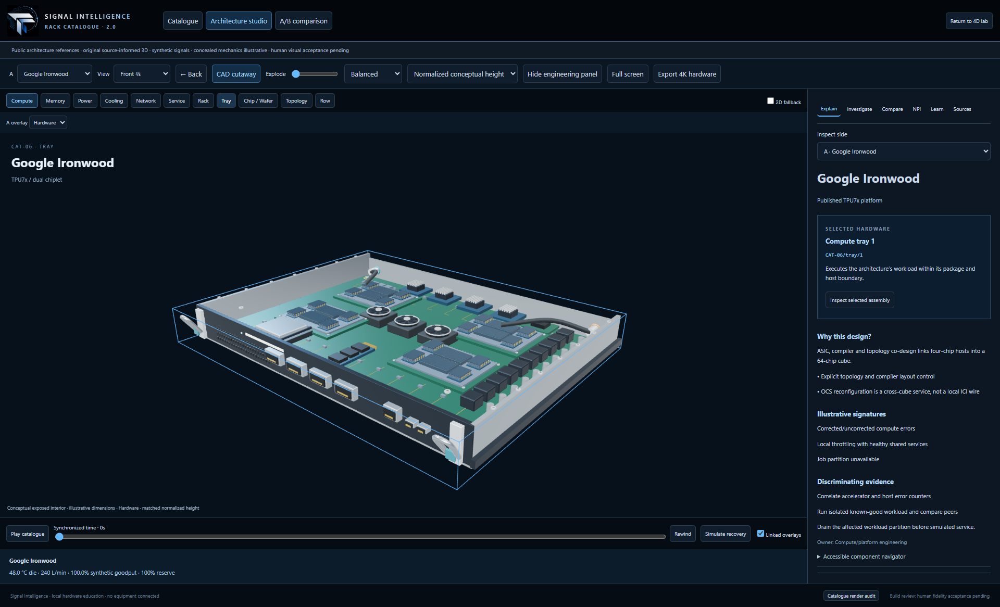
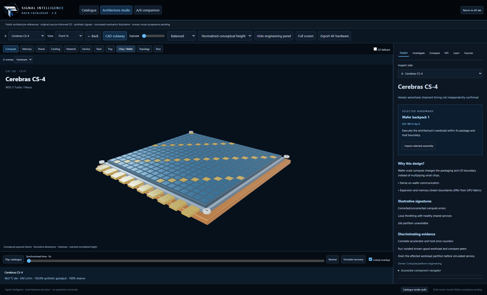

# Rack Catalogue 2.0 — review index

The ten entries are working original procedural models with automated front/rear picking and deep inspection. **User visual review: ≥90/100 for each base family.** This records the user's October 15 response, “greater than or equal to 90 for all”, as a lower bound, not exact grades. Source verification supports the stated architecture facts, not exact proprietary interiors. Rubin has not been separately scored. Remaining engineering qualification gaps are documented in CATALOGUE_ACCEPTANCE.md.

| ID / family | Physical distinction | Scope / model type | Primary reference |
|---|---|---|---|
| CAT-01 Enterprise EIA | Mixed 1U/2U-like chassis, disks, AC PDUs and rear fans | Demonstrative rack / sourced illustration | [Schneider EIA-compatible enclosure](https://shop.se.com/pro/us/en/product/apc-netshelter-sx-server-rack-gen-2-42u-1991h-x-600w-x-1070d-mm-with-sides-black-taa/) |
| CAT-02 OCP ORv3 | Wider OU tray openings, blind-mate DC contacts and copper spine | Demonstrative equipment population / sourced illustration | [OCP Sanmina listing](https://www.opencompute.org/marketplace/facilities-physical-infrastructure/sanmina-open-rack-v3-orv3/) |
| CAT-03 DGX B200 | Four large server nodes, eight packaged GPUs per detailed node, rear fans/NIC bundles | Four-node demonstrative rack / sourced illustration | [NVIDIA DGX B200](https://www.nvidia.com/en-us/data-center/dgx-b200/) |
| CAT-04 GB300 NVL72 | 18 compute trays, nine switch trays, eight power shelves, cartridge backplane and liquid manifolds | One 72-GPU rack / sourced illustration | [NVIDIA Enterprise RA](https://docs.nvidia.com/enterprise-reference-architectures/nvl72-ai-factory/latest/components.html) |
| CAT-05 AMD Helios | Double-wide stance, broad sleds, four separate scale-up cartridges and rear busbar/QDs | One 72-GPU ORW reference / sourced illustration | [AMD Helios](https://www.amd.com/en/products/rackscale-solutions/helios.html) |
| CAT-06 Ironwood | Four dual-chiplet TPUs per carrier, dense ICI harness, separate OCS module | 64-chip cube / sourced illustration | [Google Ironwood stack](https://cloud.google.com/blog/products/compute/inside-the-ironwood-tpu-codesigned-ai-stack/) |
| CAT-07 Trainium3 | Three illustrative cabinets connected by a logical grouping bridge | UltraServer logical scope / conceptual mechanics | [AWS Trn3](https://aws.amazon.com/about-aws/whats-new/2025/12/amazon-ec2-trn3-ultraservers/) |
| CAT-08 Azure Maia | Asymmetric compute/HXU service unit with exchanger/pumps and closed-loop pipes | Maia 200 demonstrative rack / sourced illustration | [Microsoft Maia 200](https://blogs.microsoft.com/blog/2026/01/26/maia-200-the-ai-accelerator-built-for-inference/) |
| CAT-09 Cerebras CS-4 | Three louvered backpacks and a large wafer-grid cutaway; distinct wafer I/O | Three-wafer CS-4 / sourced illustration | [Cerebras CS-4](https://www.cerebras.ai/cs4) |
| CAT-10 HPE Cray EX4000 | Sealed fanless front, 64 vertical blades under cutaway, adjacent CDU | Illustrative fully populated cabinet / sourced illustration | [HPE QuickSpecs](https://www.hpe.com/us/en/collaterals/collateral.a00094635enw.html) |

Each base family has two authored synthetic scenarios, a six-chapter/60-second tour, three offline self-checks, an open TPM prompt and architecture-adapted L1–L12 fixtures. Procurement cost, MTTR, deployed wattage and comparative accelerator speed are not invented.

**L1–L12 is directly accessible on every card and above each 3D pane.** Each family/generation retains its own stage, sequential evidence and signed fixture gates across refresh. See [L1–L12 workflow and validation](CATALOGUE_L1_L12.md).

## Full 4D workspace

Each card now opens the same three-panel 4D workbench used by the original application: explorer/layers, actual hardware with timeline and metrics, and component intelligence/investigation/L1–L12. [Convergence changes, workflow, current screenshots and limits](CATALOGUE_4D_CONVERGENCE.md). The prior screenshot sets below remain historical hardware proof.

## Hero before / after

- GB300: the baseline already had the v2 GB200-style geometry. This revision retains that investment and adds a generation-specific GB300 registry, correct Enterprise RA power details, independently owned switch/cartridge geometry and synchronized comparison. It does not claim that every inherited package dimension is B300 CAD.
- Helios: absent from the baseline. The new original ORW model has a substantially wider body and sleds, four independent rear cartridges, shared DC distribution and liquid QDs. UALink and scale-out Ethernet stay separate in the source/graph layers.
- Ironwood: retains the earlier four-TPU/dual-chiplet inspection. Adds a catalogue-specific carrier/rack identity, dense owned ICI harness, independently selectable OCS and a complete 64-node torus with six neighbors. It participates in synchronized camera/time/concept comparison without substituting NVIDIA fabric.

The Rubin child has distinct four-shelf rack geometry, liquid-cooled DC busbar and a two-board tray. It is selected through Generation A/B, not counted as an eleventh family. Source: [Rubin hardware manual](https://docs.nvidia.com/dgx/dgxvr-user-guide/hardware.html). TPU 8t/8i, Maia 300 and CS-3 are separately qualified source notes; unmodelled proprietary geometry is not silently inherited.

## Review images and rubric

Every family has `CAT-xx-hero/front/rear/exploded/tray/chip/topology/fault-t0/fault-t180.png` under evidence/catalogue-v2. Actual rendering previews are under public/catalogue-thumbs. Five named comparison pairs, a cooling comparison and 3840×2160 hardware export are included. Baseline images are preserved under evidence/catalogue-v2/baseline. See visual-metrics.json for exact view, camera, time, quality and renderer metadata.

Final fault, defining-component, row, comparison and gallery images were refreshed after the user's review was recorded. Earlier proof captures still show the then-current “review pending” notice; that is historical UI text rather than an outstanding base-family scoring request. Capture and refresh dates are recorded separately.

Human rubric: silhouette/packaging 25, power/cooling coherence 20, tray/connector/board service detail 15, topology 15, rear routing 10, click/drill/explode usability 10, materials/lighting 5. Specification thresholds are ≥90 for heroes and ≥80 for the other seven. The user's review reports ≥90 for all ten; no per-category breakdown or exact individual score was supplied. The registry stores 90 as the conservative lower bound and explicitly labels its origin. See evidence/catalogue-v2/human-review.json. Screenshot hashes and developer estimates are not the approval source.

## Backlog / acceptance boundary

Base family visual review is recorded; Rubin still needs separate scoring. Deferred: exact licensed CAD, undisclosed dimensions/cable inventories, detailed TPU8/Boardfly and Maia300 physical models, collision-solved service motion, vendor-calibrated dynamic models, byte-level GPU memory and long endurance testing, comprehensive screen-reader/touch/device audit. Full procurement/ECO scheduling remains a teaching fixture. These remain explicit yellow items; source-linked notes are not disguised as completed geometry. PERFORMANCE.md describes the measured native GPU sample and its limits.
