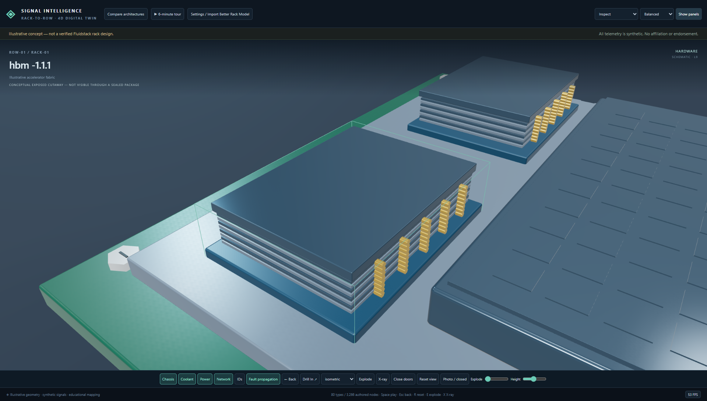
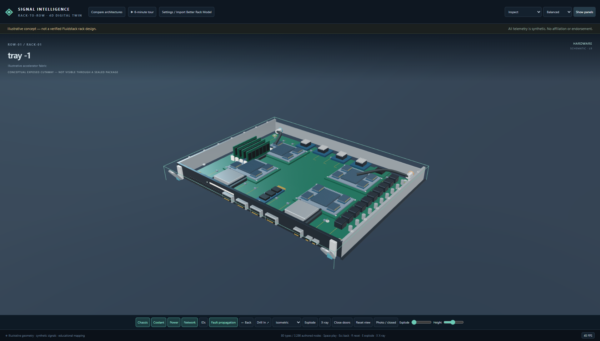
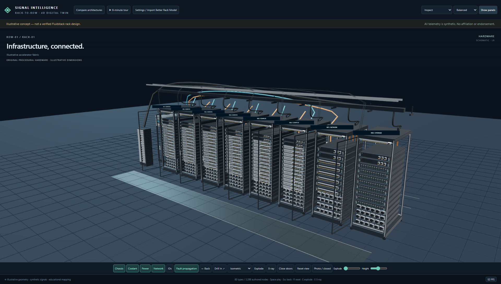
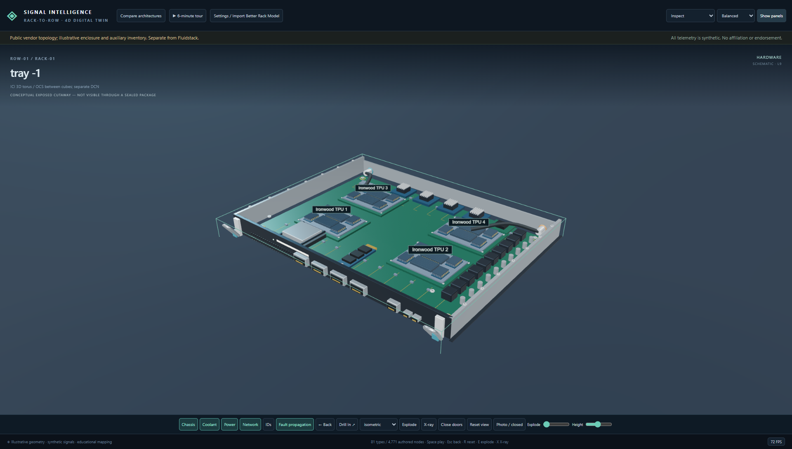

# Signal Intelligence | Rack-to-Row 4D Digital Twin

Working local React/TypeScript/WebGL educational application. No account, API key, cloud service, live facility connection or equipment control.

## Run on Windows

```powershell
& 'C:\Users\floyd\Documents\ChatGPT\Rack Models\signal-intelligence-rack-to-row-4d\scripts\start.ps1'
```

Open http://127.0.0.1:4173. Node.js 22.12+ is required. The included `dist/` production bundle runs without npm dependencies or internet when it is current. The server binds only to 127.0.0.1. Stop with Ctrl+C. Do not open index.html directly with file://; ES modules require the local server.

For source development or a rebuild, install dependencies once with internet:

```powershell
cd 'C:\Users\floyd\Documents\ChatGPT\Rack Models\signal-intelligence-rack-to-row-4d'
npm ci --offline=false
npm run build
npm test
npm run test:e2e
```

Browser tests use installed Chrome, default `C:/Program Files/Google/Chrome/Application/chrome.exe`; set `PLAYWRIGHT_CHROME_PATH` to another Chromium executable if needed. The tests start the loopback production server if it is not already running. `npm run dev` serves on 127.0.0.1:5173. Build assets use no remote fonts, textures, icons or APIs. Explicit source links open the internet only when clicked.

For a standalone static demonstration, copy `dist/` and `scripts/serve.mjs` together, keep the scripts subdirectory, and run `node scripts/serve.mjs` from that directory. No node_modules needed.

## Use

Start at L9 in the concept rack. Click real meshes or use the accessible component tree. Double-click / Drill In opens trays, boards and chip/HBM details. Back restores the saved camera context. Orbit with drag, pan with right drag, zoom with wheel/pinch. Arrow keys orbit; +/- zoom. Space plays time, Escape goes back, R resets camera, E toggles explosion and X toggles X-ray. Sliders adjust explosion and camera height.

The illustrative eight-slot row has six compute, one network and one storage role. Select 4/6/8/10/12 slots; every rack can be visited. Hardware, power, coolant, airflow, network, management, storage and dependency layers change the scene. The graph camera shows Ironwood's 64-chip 4×4×4 torus or sampled GPU fabric connections.

In Investigation, select a preset and inject. For the shared CDU case, play/scrub to see low flow/pressure precede thermal rise and throttling. Collect the two discriminating tests; collecting an alarm-only context check does not earn full evidence credit. Choose containment, apply simulated recovery, choose a hypothesis and make a release decision. Export reports and versioned replay JSON. Rewinding recomputes snapshots from events. Current engine supports one active root fault at a time; later injection supersedes the earlier active root cause.

Gate evidence has 12 sequential assembly/product-integration stages, three tests and three incidents per stage; facility readiness is a separate seven-gate track. Fixtures are synthetic evidence, not signed physical qualification. Build-time scrubbing changes installation stage and fictional BOM/program context; runtime scrubbing drives physical response.

Settings contains guided, challenge, executive and presenter modes, four role questions, reduced motion, accessible fallback and local model import. The tour runs for six minutes and supports chapter stepping. The final release decision is intentionally user-owned.

## Better models later

Use Settings → Import Better Rack Model. GLB/glTF must embed resources; STL is supported; PNG is a flat reference plane. CAD/USDZ should be exported to GLB with appropriate licensing first. Import is browser-local, 50 MiB maximum, 2,000 meshes and one million vertices; external resources and unsupported extensions are rejected. Enter attribution and license, select mesh, search a stable component ID, bind, adjust scale/rotation/X-ray, and validate/apply. Export mapping JSON for reuse. Mapping is saved in localStorage; the local asset file must be selected again after reload. Geometry never replaces authored component facts, scenario events or component IDs. An original tiny GLB QA fixture is under tests/fixtures; it is not a production rack model.

The adapter currently provides searchable per-mesh binding, not drag/drop multi-mesh grouping or automatic semantic recognition. Partial bindings retain all data in the tree, but do not provide a mesh for every unbound component. Audit those gaps before treating an imported model as an interactive replacement. The procedural model can always be restored.

## Data and maintenance

- `src/data/components/catalog.json`: 80 authored type-specific principle/signature/differential/test/owner entries.
- `src/data/model.ts`: strongly typed records, stable IDs, procedural inventory and schema audit.
- `src/data/profiles/*.json`: replaceable profile counts and labels.
- `src/data/levels.json`: editable educational L1–L12 mapping.
- `src/data/failures/incidents.ts`: 36 investigations, including six tailored shared-cause/red-herring cases.
- `src/data/sources.json`: checked source manifest with claim scope and licensing notes.
- `src/graphs/`: physical service dependencies separate from vendor fabric topology.
- `src/simulation/`: deterministic fixed-step water heat balance, lumped thermal model and diagnostic telemetry.
- `src/import/`: local asset security preflight, loading and versioned bindings.
- `evidence/`: ten screenshots, replay fixture and performance baseline.

Read ACCEPTANCE_MATRIX.md for exact verification and gaps. Not all ambitious specification items are fully implemented; this handoff does not claim every checkbox is green.

This is an educational/illustrative AI-infrastructure digital twin and not an official Fluidstack mechanical design or deployment record.

## V2 hardware overhaul

The physical scene now includes layered HBM/package context, mechanical compute trays, PCB components, distinct rack faceplates and rear service hardware, and connected CDU/coolant/power/network row infrastructure. Inspect presents the hardware; Diagnose retains incident tools; Assembly Timeline retains L1–L12. Collapse panels for presentation. Photo/closed and CAD cutaway distinguish externally visible hardware from conceptual exposed internals. Performance uses simpler local shading; Balanced and Detail use PBR.





Read [VISUAL_FIDELITY_DELTA.md](VISUAL_FIDELITY_DELTA.md) for before/after, engineering assumptions, tests, measured native/software performance and remaining gaps. Final evidence and reproducible capture scripts are under `evidence/v2` and `scripts/capture-v2.mjs`. With the local server running, `node scripts/capture-v2.mjs` uses software rendering; set `NATIVE_GPU=1` for native ANGLE D3D11 and separate metrics. No new runtime dependencies or remote assets are required.

Ironwood inspection: choose **Google Ironwood cube**, drill into a compute tray, and use **CAD cutaway** to see four individually selectable, labeled TPU packages. Package drill shows the two conceptual chiplets. The 16-tray/64-chip cube and TPU ICI/OCS topology are preserved.


